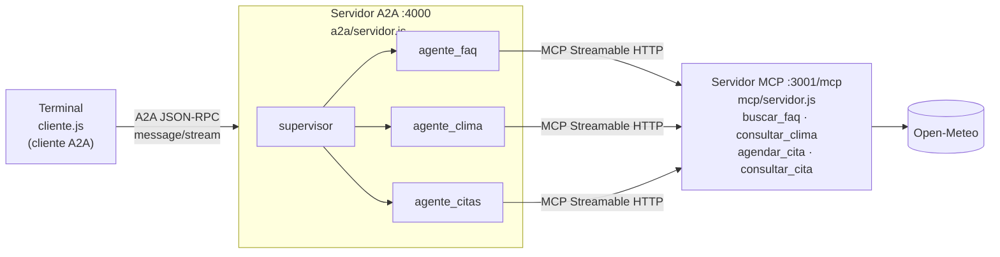

# Hoja de Trabajo 7 - Protocolos Agénticos

El sistema multiagente de Parachute S.A. (Hoja 5, arquitectura centralizada) se expone con dos protocolos:

- **MCP**: las herramientas de todos los agentes viven en un solo servidor MCP con transporte **Streamable HTTP**.
- **A2A**: el sistema multiagente completo se publica como **un solo agente** con tres skills, y la interfaz de terminal es un **cliente A2A**.



## Componentes

| Archivo | Rol |
| --- | --- |
| [`mcp/servidor.js`](mcp/servidor.js) | Servidor MCP ([SDK oficial](https://modelcontextprotocol.io)) con transporte Streamable HTTP en `http://localhost:3001/mcp`. Registra `buscar_faq`, `consultar_clima`, `agendar_cita` y `consultar_cita`, y emite un log por cada ejecución (argumentos, resultado y duración). |
| [`src/agentes.js`](src/agentes.js) | Sistema multiagente con el [SDK de agentes de OpenAI](https://openai.github.io/openai-agents-js/guides/mcp/). Cada especialista se conecta al servidor MCP con `MCPServerStreamableHttp` y un `toolFilter` que le deja ver solo sus herramientas. El supervisor usa a los especialistas como herramientas (`asTool`). |
| [`a2a/servidor.js`](a2a/servidor.js) | Servidor A2A ([`@a2a-js/sdk`](https://a2a-protocol.org/latest/), protocolo v1.0). Publica la Agent Card en `/.well-known/agent-card.json` y atiende JSON-RPC en `/a2a/jsonrpc`. Su `AgentExecutor` ejecuta al supervisor, publica el progreso como actualizaciones de estado de la tarea y guarda el historial por `contextId`. |
| [`cliente.js`](cliente.js) | Interfaz de terminal como cliente A2A: descubre al agente por su Agent Card (`ClientFactory.createFromUrl`), envía mensajes con streaming y reutiliza el `contextId` para mantener la conversación. |
| [`src/servicios/`](src/servicios/) | Lógica de negocio de la Hoja 5 (FAQs, clima con Open-Meteo, criterios de seguridad y citas), usada solo por el servidor MCP. |

### Skills del agente A2A

| Skill | Descripción |
| --- | --- |
| `preguntas_frecuentes` | Horario, costo, consultas virtuales, cancelación, ubicación y formas de pago. |
| `evaluar_clima` | Pronóstico del sitio de aterrizaje y veredicto IDEAL / MARGINAL / PROHIBIDO (máximo 16 días). |
| `agendar_citas` | Agenda saltos solo si el clima es seguro y consulta citas por identificador. |

## Ejecución

```bash
npm install
cp .env.example .env    # agregar GOOGLE_API_KEY (gratis en https://aistudio.google.com/apikey)
```

En tres terminales distintas, en este orden:

```bash
npm run mcp       # 1. Servidor MCP   -> http://localhost:3001/mcp
npm run a2a       # 2. Servidor A2A   -> http://localhost:4000
npm run cliente   # 3. Terminal como cliente A2A
```

El cliente también acepta un mensaje directo: `node cliente.js "¿Cuál es el horario de atención?"`.

Pruebas de la lógica de negocio (sin llamadas al modelo): `npm test`.

## Ejemplo de logs

Mensaje: *"Quiero agendar un salto el 2026-10-22 a las 10:00, soy Ana López, ana@example.com"*

Cliente A2A:

```
Tú: Quiero agendar un salto el 2026-10-22 a las 10:00, soy Ana López, ana@example.com
  [Procesando la solicitud...]
  [supervisor → agente_clima]

Asistente Parachute S.A.: Hola Ana. Lamentablemente no podemos agendar tu cita para el 22 de octubre de 2026, ya que el pronóstico indica precipitación...
```

Servidor A2A:

```
[A2A] POST /a2a/jsonrpc
[A2A] tarea 6de4dccf (contexto b3928e30) recibida: "Quiero agendar un salto el 2026-10-22 ..."
[A2A]   supervisor → agente_clima
[A2A]     agente_clima → consultar_clima (MCP)
[A2A] tarea 6de4dccf completada: "Hola Ana. Lamentablemente no podemos agendar ..."
```

Servidor MCP:

```
[MCP] → consultar_clima {"fecha":"2026-10-22"}
[MCP] ← consultar_clima (816 ms) {"fecha":"2026-10-22","pronostico":{...,"precipitacion_mm":10.2,...},"veredicto":"PROHIBIDO",...}
```
